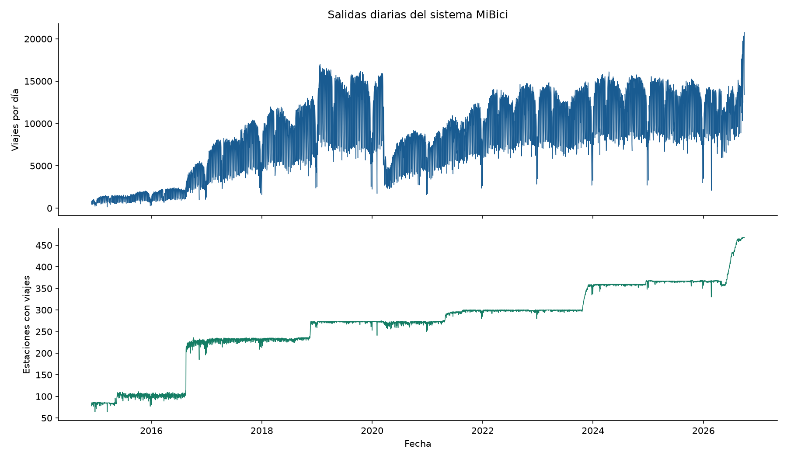
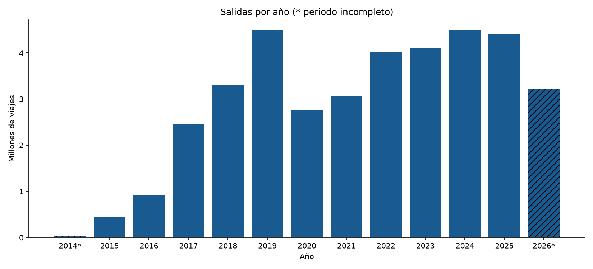
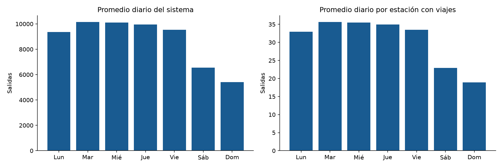
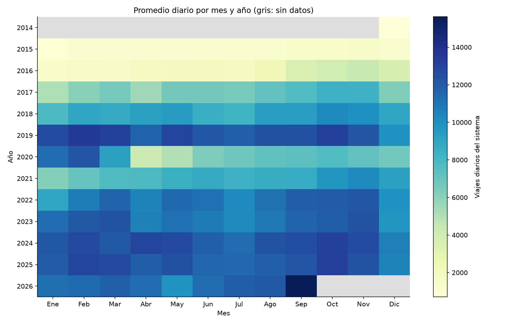
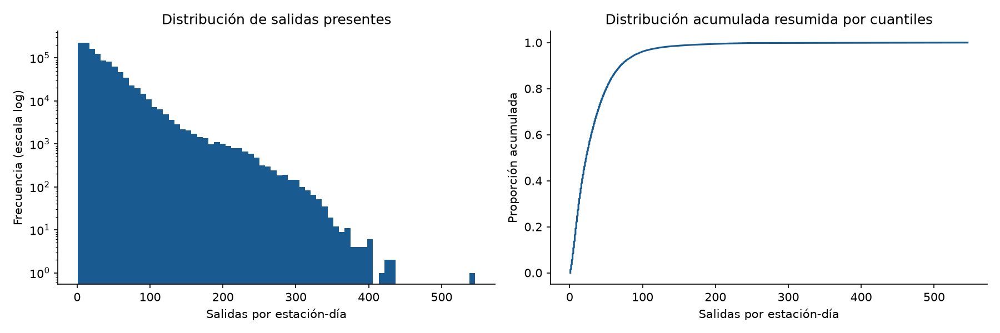
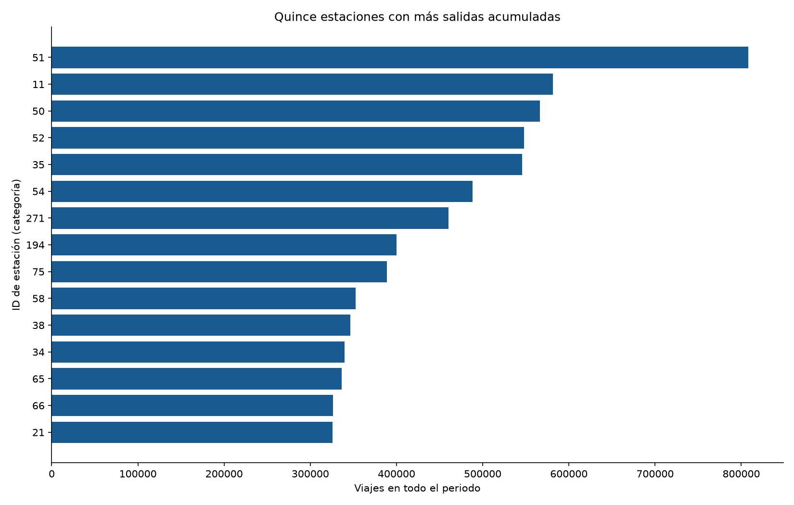
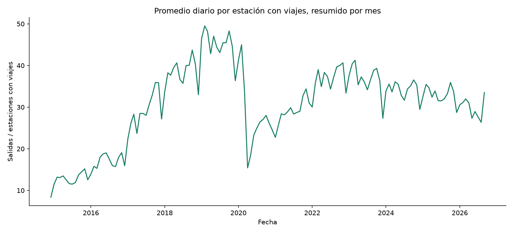
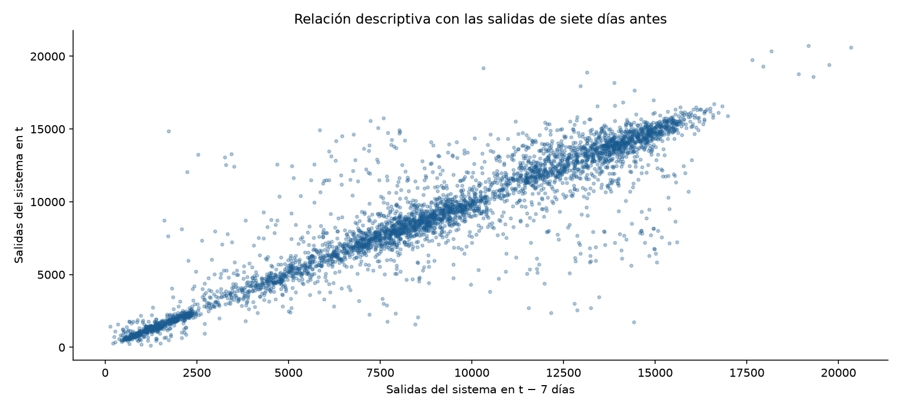

# Análisis exploratorio del histórico MiBici

Se analiza el uso realizado de MiBici por estación y día para preparar un futuro
modelo de salidas. El agregado cubre 2014-12-01 a 2026-09-30:
37,725,836 salidas, 1,160,636 estación-días presentes
y 486 IDs de estación distintos. La variación temporal y de
cobertura exige considerar calendario e historia anterior, sin confundir viajes
observados con disponibilidad de bicicletas o demanda insatisfecha.

## 1 Diagnóstico y conciliación

El reporte de preparación registra 39,078,984 viajes originales, 1,353,148 exclusiones y 37,725,836 viajes retenidos. La suma de salidas y la cantidad de filas coinciden con ese reporte.

Se validaron columnas, fechas, IDs positivos, conteos enteros no negativos y
unicidad de la clave estación-fecha. Hay 0
filas con cero explícito. En un calendario de 4,322 días,
4,322 tienen datos y 0 no tienen observaciones
del sistema. Las fechas ausentes se conservan como faltantes; no se imputan a cero.

## 2 Evolución y cobertura

El promedio del sistema es 8,728.8 viajes por día con datos.
El número diario de estaciones con viajes oscila entre
64 y 468.
Los cambios del total deben interpretarse junto con esa cobertura. Una estación
sin viajes no puede clasificarse como cerrada con estos datos.

| Año | Salidas | Días con datos | Año calendario completo |
| --- | ---: | ---: | --- |
| 2014 | 21,820 | 31 | No |
| 2015 | 451,532 | 365 | Sí |
| 2016 | 913,506 | 366 | Sí |
| 2017 | 2,454,487 | 365 | Sí |
| 2018 | 3,312,283 | 365 | Sí |
| 2019 | 4,496,473 | 365 | Sí |
| 2020 | 2,770,621 | 366 | Sí |
| 2021 | 3,066,938 | 365 | Sí |
| 2022 | 4,008,945 | 365 | Sí |
| 2023 | 4,104,395 | 365 | Sí |
| 2024 | 4,489,259 | 366 | Sí |
| 2025 | 4,408,248 | 365 | Sí |
| 2026 | 3,227,329 | 273 | No |

Los años incompletos se señalan con asterisco y trama. Sus totales no son directamente
comparables con los de un año completo. Los cambios entre años también pueden
reflejar crecimiento de la red y diferencias de captura; no se establece causalidad.

## 3 Patrones de calendario

El mayor promedio de viajes del sistema corresponde a
**Martes**. Es una asociación del periodo
completo, que mezcla años y configuraciones de red. Se presenta también el cociente
diario de salidas entre estaciones con viajes para observar el efecto de cobertura.

El mapa de calor usa promedio diario, en lugar de comparar meses de distinta
duración por su total. El gris representa ausencia de datos, no cero viajes.

## 4 Distribución y posibles atípicos

La mediana por estación-día presente es 23.0;
el percentil 99 es 167.0 y el máximo es
546. La distribución debe revisarse por estación y
periodo antes de elegir una función de pérdida o una transformación del objetivo.

La regla IQR agrupada señala 55,003 filas fuera de
[-38.5, 93.5]. Al calcularla dentro de cada
estación aparecen 8,586 alertas. Son diagnósticos
descriptivos: **no se elimina ninguna fila**. La regla agrupada mezcla estaciones
con niveles de uso y periodos diferentes; un conteo alto puede ser uso real.

## 5 Diferencias entre estaciones

Las diez estaciones con mayor volumen acumulan 13.6%
de las salidas. El ranking histórico mezcla intensidad de uso y tiempo observado;
la tabla estaciones.csv incluye días presentes y promedio condicionado a esos días.
Primera y última fecha observadas no prueban fechas de apertura o cierre.

El denominador del cociente son estaciones **con viajes**, no estaciones activas.
Por tanto, este cociente no estima demanda por estación operativa ni resuelve
por sí mismo cambios de composición de la red.

## 6 Relaciones temporales

| Rezago en días | Pares disponibles | Pearson | Spearman |
| --- | ---: | ---: | ---: |
| 1 | 4,321 | 0.851 | 0.820 |
| 7 | 4,315 | 0.936 | 0.924 |
| 28 | 4,294 | 0.882 | 0.864 |

Los rezagos corresponden a fechas exactas del calendario. Las correlaciones del
total del sistema pueden reflejar tendencia, cobertura y calendario compartidos;
no demuestran capacidad predictiva fuera de muestra y no se interpretan p-valores.
No se correlaciona el ID de estación con las salidas, porque es una categoría.

## 7 Consecuencias para el preprocesamiento

1. Separar por fecha antes de ajustar transformaciones aprendidas de los datos.
2. Representar estación como categoría y calendario mediante variables justificadas.
3. Construir rezagos y medias exclusivamente con información disponible antes del objetivo.
4. Evaluar estaciones nuevas y cambios de cobertura por separado.
5. Resolver la representación de ceros con información histórica de operación o una
   suposición explícita; no completar automáticamente toda estación en todo día.
6. Justificar normalización según el modelo. No aplicar PCA ni borrar picos de uso
   automáticamente solo por ser técnicas disponibles.

## 8 Alcance y trazabilidad

Este EDA no cambia, limpia de nuevo, normaliza ni completa el dataset. Se conserva
la huella SHA-256 del CSV, las tablas, las figuras, las versiones de librerías y el
código. El notebook utiliza funciones del módulo para evitar duplicar la lógica.

Se adaptó la estructura metodológica del notebook previo A03_A01797108 de Room
Occupancy: diagnóstico, comprobaciones, estadística univariada, ECDF, IQR y
conclusiones. No se trasladaron los límites de sensores, las clases de ocupación,
la imputación ni las comparaciones contra original.csv, que no corresponden a MiBici.

El análisis retrospectivo describe todo el histórico. Si se usa para seleccionar
variables o tomar decisiones de modelado, habrá que repetir esa selección en el
periodo de entrenamiento y reservar prueba sin usarla para ajustar el modelo.
